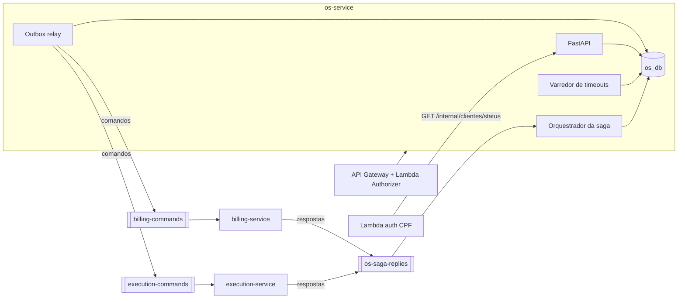
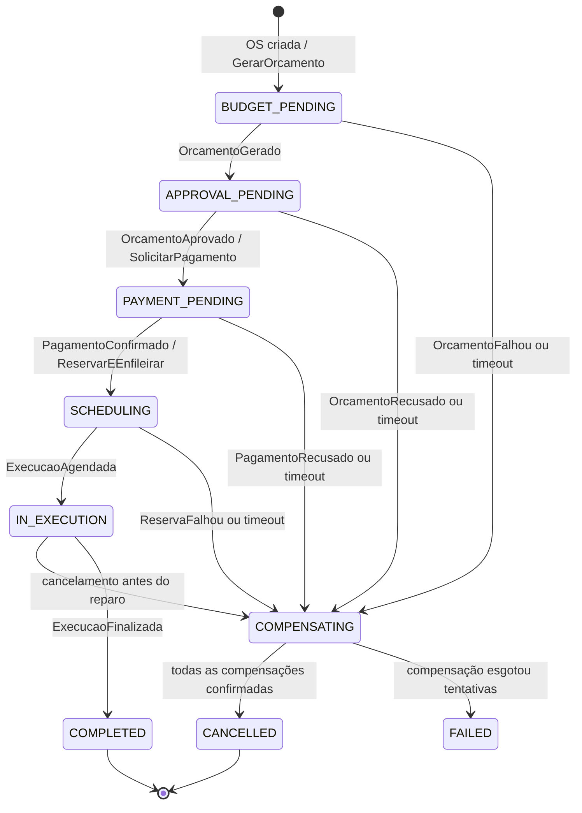
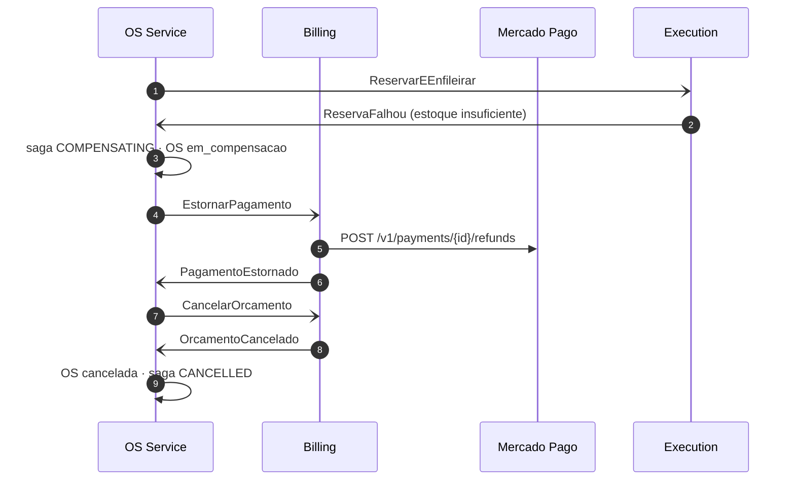

# fiap-officine-os-service

[](https://sonarcloud.io/summary/new_code?id=fiap-officine_fiap-officine-os-service)
[](https://sonarcloud.io/summary/new_code?id=fiap-officine_fiap-officine-os-service)

Microsserviço de **Ordens de Serviço** da oficina e **orquestrador da Saga** da
OS. Tech Challenge SOAT — Fase 4.

| | |
|---|---|
| Responsabilidades | Clientes, veículos, catálogo (serviços e peças: nome/preço), abertura e acompanhamento de OS, histórico, **orquestração da saga**, entrega do veículo, login admin |
| Banco | PostgreSQL `os_db` (RDS compartilhado, banco lógico e usuário próprios) |
| Mensageria | Amazon SQS — publica em `billing-commands` / `execution-commands`, consome `os-saga-replies` |
| Outros serviços | [billing-service](https://github.com/fiap-officine/fiap-officine-billing-service) (orçamento, Mercado Pago) · [execution-service](https://github.com/fiap-officine/fiap-officine-execution-service) (estoque, fila de execução, DynamoDB) |

## Arquitetura



Consumer, outbox relay e varredor rodam como threads no mesmo processo da API
(`RUN_WORKERS=true`) para caber no nó K3s t3.micro; podem rodar separados com
`python -m app.worker`.

## Saga Pattern — escolha e justificativa

Adotamos uma **saga orquestrada**, com o orquestrador dentro do OS Service, porque:

1. **O fluxo é linear e tem esperas longas** (aprovação do cliente e confirmação do
   pagamento). Um orquestrador com estado persistido (`saga_instances`) trata
   timeouts e retomadas de forma explícita.
2. **A OS é o agregado dono do processo**: o status da OS, o estado da saga e as
   mensagens do outbox são gravados na mesma transação.
3. **Compensações centralizadas e legíveis**: a ordem de rollback está em um único
   lugar ([app/saga/orchestrator.py](app/saga/orchestrator.py)), em vez de espalhada
   em handlers de eventos de vários serviços.
4. **Observabilidade**: `GET /api/v1/ordens-servico/{id}/saga` mostra o passo atual,
   o prazo, as compensações pendentes e a linha do tempo de comandos/respostas.
5. **Sem dependências cíclicas**: Billing e Execution não se conhecem; só respondem
   a comandos.

**Trade-offs aceitos:** o orquestrador concentra lógica (mitigado por ser stateless,
com estado no banco e escalável horizontalmente) e o OS Service conhece os
contratos dos outros serviços.

### Passos e compensações

| # | Passo | Comando | Sucesso | Falha | Compensação |
|---|---|---|---|---|---|
| T1 | Criar OS (local) | — | — | 4xx | cancelar OS |
| T2 | Gerar orçamento (Billing) | `GerarOrcamento` | `OrcamentoGerado` | `OrcamentoFalhou` / timeout | `CancelarOrcamento` |
| T3 | Aprovação do cliente (Billing, REST) | — | `OrcamentoAprovado` | `OrcamentoRecusado` / timeout 48h | — |
| T4 | Pagamento (Billing + Mercado Pago) | `SolicitarPagamento` | `PagamentoConfirmado` | `PagamentoRecusado` / timeout | `EstornarPagamento` |
| T5 | Reservar peças + enfileirar (Execution) | `ReservarEEnfileirar` | `ExecucaoAgendada` | `ReservaFalhou` / timeout | `LiberarReserva` |
| T6 | Diagnóstico → reparo → finalização | — | `DiagnosticoIniciado`, `ReparoIniciado`, `ExecucaoFinalizada` | — | **nenhuma (pivô)** |

As compensações rodam **em ordem inversa e uma por vez** (cada uma espera a
confirmação do participante): `LiberarReserva → EstornarPagamento →
CancelarOrcamento → OS cancelada`.

| Falha em | Compensações |
|---|---|
| T2 | cancelar OS |
| T3 recusa/timeout | `CancelarOrcamento` → cancelar OS |
| T4 recusa/timeout | `CancelarOrcamento` → cancelar OS |
| T5 estoque insuficiente | `EstornarPagamento` → `CancelarOrcamento` → cancelar OS |
| Cancelamento com OS na fila | `LiberarReserva` → `EstornarPagamento` → `CancelarOrcamento` → cancelar OS |

**Pivô:** a partir de `ReparoIniciado` (OS `em_execucao`) a saga não compensa mais
— peças já foram usadas. Falhas viram recuperação para frente (retry/intervenção
manual) e `POST /cancelar` responde `409`.

### Máquina de estados



Status da OS: `recebida → aguardando_orcamento → aguardando_aprovacao →
aguardando_pagamento → aguardando_execucao → em_diagnostico → em_execucao →
finalizada → entregue`; antes do pivô, qualquer estado pode ir para
`em_compensacao → cancelada`.

### Sequência — falha com compensação (estoque insuficiente após pagamento)



### Garantias técnicas

| Garantia | Implementação |
|---|---|
| Não perder mensagens | **Transactional Outbox** ([app/messaging/outbox.py](app/messaging/outbox.py)): comando gravado na mesma transação do estado; relay publica e marca `sent` |
| Duplicatas (SQS at-least-once) | `processed_messages(message_id PK)` na mesma transação do efeito ([app/messaging/consumer.py](app/messaging/consumer.py)) |
| Mensagens venenosas | Exceção → mensagem volta à fila; após 5 tentativas vai para a DLQ (alerta no New Relic) |
| Respostas que nunca chegam | `deadline_at` por passo + varredor: dispara compensação; compensação sem resposta é reenviada até `SAGA_COMPENSATION_MAX_ATTEMPTS` e então a saga vai para `FAILED` |
| Concorrência | `SELECT ... FOR UPDATE` na linha da saga |
| Eventos fora de ordem | Progresso da execução avança pelos estados intermediários; eventos atrasados não regridem a OS |
| Respostas tardias | Pagamento confirmado/reserva efetivada depois da compensação geram `EstornarPagamento`/`LiberarReserva` adicionais |

Contratos das mensagens: [docs/contracts](docs/contracts/README.md).

## API

Swagger: `/docs` · OpenAPI exportado: [docs/openapi.json](docs/openapi.json)

| Método | Rota | Descrição |
|---|---|---|
| POST | `/api/v1/ordens-servico/` | Abre a OS e inicia a saga |
| GET | `/api/v1/ordens-servico/{id}` | Detalhe + histórico |
| GET | `/api/v1/ordens-servico/{id}/saga` | Estado e linha do tempo da saga |
| POST | `/api/v1/ordens-servico/{id}/cancelar` | Dispara compensações (409 após o pivô) |
| POST | `/api/v1/ordens-servico/{id}/entregar` | Entrega do veículo (após `finalizada`) |
| GET | `/api/v1/ordens-servico/minhas-ordens` | OS do cliente autenticado (JWT CPF) |
| CRUD | `/api/v1/clientes`, `/veiculos`, `/servicos`, `/pecas` | Cadastros (peças = catálogo; estoque no Execution) |
| GET | `/internal/clientes/status/{cpf}` | Usado pela Lambda (header `x-internal-token`) |
| GET | `/health` | Banco, SQS e tamanho do outbox |

O fluxo E2E completo está na collection Postman do repositório `fiap-officine-e2e`.

## Rodando localmente

```bash
docker compose up --build        # Postgres + LocalStack (SQS) + os-service
# http://localhost:8000/docs
```

Sem Docker: `uv sync && cp .env.example .env && uv run alembic upgrade head && uv run uvicorn app.main:app --reload`.

## Testes

```bash
uv run pytest            # unit + integração + BDD, falha abaixo de 80% de cobertura
uv run pytest tests/bdd  # só a saga em Gherkin
```

- **BDD** ([tests/bdd/features/saga_ordem_servico.feature](tests/bdd/features/saga_ordem_servico.feature)):
  roda o orquestrador real e participantes fake de Billing/Execution trocando
  mensagens pelo SQS (mockado com `moto`). Cenários: fluxo feliz, recusa do
  orçamento, estoque insuficiente com estorno, timeout de pagamento,
  cancelamento com OS na fila e mensagem duplicada.
- **Cobertura atual: 94% (branch coverage, sem exclusões)** — relatório no
  SonarCloud (badge acima) e em `coverage.xml` gerado pelo CI.

## CI/CD

[.github/workflows/ci-cd.yml](.github/workflows/ci-cd.yml): lint → testes (gate 80%)
→ SonarCloud (Quality Gate) → build/push no ECR com tag = SHA → bootstrap do
`os_db` → `kustomize edit set image` + `rollout status` → smoke test.
Ambiente único **homolog** (projeto acadêmico): o push em `develop` ou em `main`
publica no cluster K3s de homolog. A `main` é protegida (PR + checks `test` e
`quality` obrigatórios). Para um ambiente de produção, basta criar um overlay
`k8s/overlays/production` e um `infra/env/production.tfvars` e apontar o job.

[.github/workflows/infra.yml](.github/workflows/infra.yml): Terraform de
[infra/](infra/) (fila `os-saga-replies` + DLQ, política IAM) — `plan` no PR,
`apply` no push.

### Secrets e variáveis dos pipelines

Configurar como secrets da organização (ou do repositório/*environment* `homolog`).
Kubeconfig, endpoint e master do RDS, URL do API Gateway e role do nó são lidos do
**SSM Parameter Store** (`/fiap-officine/homolog/...`), publicados pelos repositórios
`fiap-officine-kubernets` e `fiap-officine-database`; os itens marcados como opcionais
só são usados se o parâmetro não existir.

| Nome | os-service | billing-service | execution-service | lambda |
|---|---|---|---|---|
| `AWS_ACCESS_KEY_ID` / `AWS_SECRET_ACCESS_KEY` (`AWS_SESSION_TOKEN` se Learner Lab) | ✔ | ✔ | ✔ | ✔ |
| `SONAR_TOKEN` | ✔ | ✔ | ✔ | ✔ |
| `KUBE_CONFIG_DATA` (opcional: o nó K3s publica o kubeconfig no SSM) | ✔ | ✔ | ✔ | |
| `JWT_SECRET_KEY` (o mesmo em todos) | ✔ | ✔ | ✔ | ✔ |
| `DB_USER` / `DB_PASSWORD` (usuário do banco lógico do serviço; no environment `homolog`) | ✔ | ✔ | | |
| `DB_ADMIN_USER` / `DB_ADMIN_PASSWORD` (opcional: o fiap-officine-database publica o master no SSM) | ✔ | ✔ | | |
| `INTERNAL_API_TOKEN` | ✔ | | | ✔ |
| `MP_ACCESS_TOKEN` / `MP_WEBHOOK_SECRET` | | ✔ | | |
| `NEW_RELIC_LICENSE_KEY` | ✔ | ✔ | ✔ | |
| Variável `K3S_NODE_ROLE_NAME` (opcional: lida do SSM) | ✔ | ✔ | ✔ | |
| Variável `OS_SERVICE_URL` (opcional: lida do SSM) | | | | ✔ |

## Observabilidade

New Relic APM (`officine-os-service`), logs JSON com `correlation_id`, `saga_id` e
`os_id`, distributed tracing atravessando o SQS (headers no campo `trace` do
envelope) e eventos customizados `SagaStepEvent`, `SagaCompensationEvent` e
`SagaFailedEvent`. Detalhes em [docs/observability.md](docs/observability.md).

## Banco de dados próprio

A instância RDS (Free Tier) é compartilhada, mas cada serviço tem **banco lógico e
usuário próprios, sem GRANT cruzado e com CONNECT revogado de PUBLIC**
([k8s/jobs/db-bootstrap.yaml](k8s/jobs/db-bootstrap.yaml)). Nenhum serviço acessa o
banco de outro — inclusive a Lambda de autenticação, que agora consulta
`/internal/clientes/status/{cpf}`.
